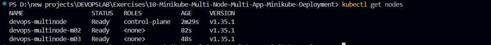
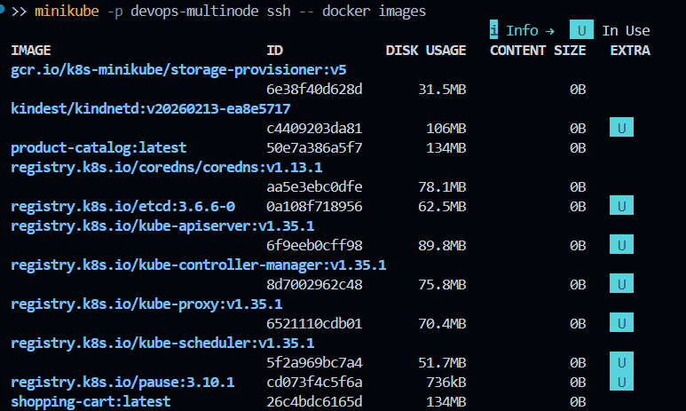
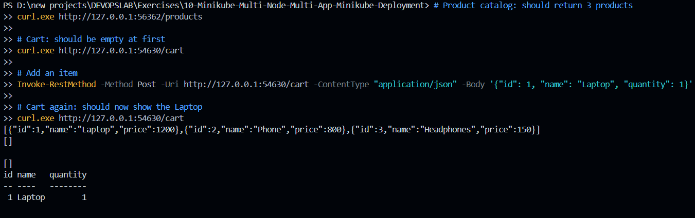

# Exercise 10 – Multi-Node Kubernetes Cluster with Multiple Applications and ReplicaSets

## Objective

Deploy two Flask microservices (Product Catalog and Shopping Cart) on a 3-node Minikube cluster using Deployments with ReplicaSets and pod anti-affinity, so that every replica runs on a different node. Expose both services using NodePort Services, test the APIs, and observe how the cluster behaves when a node is stopped.

## Scenario

An online store needs high availability for critical services such as product browsing and cart management.

| Service | Application | Replicas |
|---------|-------------|----------|
| Product Catalog | AppA | 2 |
| Shopping Cart | AppB | 3 |

Replicas are spread across multiple nodes so that the failure of a single node does not take a service down.

## Environment

* OS: Windows 11
* Kubernetes: v1.35.1
* Minikube: v1.38.1
* Container Runtime: Docker
* Shell: PowerShell (VS Code integrated terminal)
* Applications: Python 3.9 + Flask

## 1. Clean Up and Start the Multi-Node Cluster

Remove any existing Minikube clusters:

```powershell
minikube delete --all
```

Start a 3-node cluster in a profile named `devops-multinode`:

```powershell
minikube start --nodes 3 -p devops-multinode --driver=docker
```

Verify the nodes:

```powershell
kubectl get nodes
```

Output:

```text
NAME                   STATUS   ROLES           AGE     VERSION
devops-multinode       Ready    control-plane   2m29s   v1.35.1
devops-multinode-m02   Ready    <none>          82s     v1.35.1
devops-multinode-m03   Ready    <none>          48s     v1.35.1
```

All three nodes (one control-plane and two workers) are in the `Ready` state.



## 2. Create the Applications

Two Flask applications were created in the exercise folder.

**Product Catalog** (`product_catalog.py`) exposes `GET /products`, which returns a static list of three products.

**Shopping Cart** (`shopping_cart.py`) exposes:

* `GET /cart` to view the cart
* `POST /cart` to add an item to the cart

Both applications listen on port `80`.

## 3. Dockerize the Applications

Each application has its own Dockerfile (`Dockerfile.product` and `Dockerfile.shopping`), both based on `python:3.9-slim` with Flask installed.

Build the images:

```powershell
docker build -t product-catalog:latest -f Dockerfile.product .
docker build -t shopping-cart:latest -f Dockerfile.shopping .
docker images
```

## 4. Load the Images into Minikube

In a multi-node cluster, images built on the host are not automatically available on every node. Load them into all nodes of the profile:

```powershell
minikube -p devops-multinode image load product-catalog:latest
minikube -p devops-multinode image load shopping-cart:latest
```

Verify the images inside the Minikube node:

```powershell
minikube -p devops-multinode ssh -- docker images
```

The output lists the Kubernetes system images (`kube-apiserver`, `kube-scheduler`, `etcd`, `coredns`, `pause`, etc.) along with the two application images, `product-catalog:latest` and `shopping-cart:latest`.



## 5. Deploy the Applications

Two Deployments were created:

* `product-catalog` with `replicas: 2`
* `shopping-cart` with `replicas: 3`

Both use `imagePullPolicy: Never` so Kubernetes uses the locally loaded images instead of pulling from a registry.

Each Deployment also defines a `podAntiAffinity` rule:

```yaml
affinity:
  podAntiAffinity:
    requiredDuringSchedulingIgnoredDuringExecution:
    - labelSelector:
        matchLabels:
          app: product-catalog
      topologyKey: "kubernetes.io/hostname"
```

This rule forbids two pods of the same application from being scheduled on the same node. Because the Shopping Cart has 3 replicas and the cluster has 3 nodes, each node runs exactly one cart pod.

Apply the Deployments:

```powershell
kubectl apply -f product_catalog_deployment.yaml
kubectl apply -f shopping_cart_deployment.yaml
```

## 6. Expose the Services

Both applications are exposed using NodePort Services:

```powershell
kubectl apply -f product_catalog_service.yaml
kubectl apply -f shopping_cart_service.yaml
```

## 7. Verify Pod Distribution

```powershell
kubectl get pods -o wide
```

Result:

* The two `product-catalog` pods are running on `devops-multinode-m02` and `devops-multinode-m03`.
* The three `shopping-cart` pods are spread across the control-plane node, `m02`, and `m03`.
* All pods are `Running` with `READY 1/1` and have unique IP addresses.

No two replicas of the same application share a node, so the anti-affinity rule is working as intended.


## 8. Access the Services

Because the Docker driver is used on Windows, each service needs its own tunnel, and the terminal must stay open while the tunnel is running.

Terminal 2:

```powershell
minikube -p devops-multinode service product-catalog-service --url
```

Terminal 3:

```powershell
minikube -p devops-multinode service shopping-cart-service --url
```

Output:

```text
http://127.0.0.1:56362   (Product Catalog)
http://127.0.0.1:54630   (Shopping Cart)
```

## 9. Test the APIs

Run these from the original terminal:

```powershell
# Product catalog: should return 3 products
curl.exe http://127.0.0.1:56362/products

# Cart: should be empty at first
curl.exe http://127.0.0.1:54630/cart

# Add an item (Laptop)
Invoke-RestMethod -Method Post -Uri http://127.0.0.1:54630/cart -ContentType "application/json" -Body '{ "id": 1, "name": "Laptop", "quantity": 1 }'

# Cart again: should now show the Laptop
curl.exe http://127.0.0.1:54630/cart
```

Results:

* `/products` returned `Laptop`, `Phone`, and `Headphones`.
* The cart was initially empty: `[]`.
* After the `POST` request, `Laptop` was added with `quantity = 1`.
* The final `GET /cart` returned the Laptop item.



> In PowerShell, `curl` is an alias for `Invoke-WebRequest`, so `curl.exe` is used for `GET` requests. `Invoke-RestMethod` is used for the `POST` request to avoid JSON quoting problems.

## 10. Fault Tolerance Demo

Stop one of the worker nodes:

```powershell
minikube -p devops-multinode node stop devops-multinode-m02
```

Check the pods again:

```powershell
kubectl get pods -o wide
```

Result:

* Minikube reported `Successfully stopped node devops-multinode-m02`.
* The pods still appeared on `m02` as well as on `m03` and the control-plane node.

Kubernetes does not react to a node failure instantly. The node controller first waits for the node to be marked `NotReady`, and by default pods on an unreachable node are evicted only after a grace period of about 5 minutes. Pods on the remaining nodes continue to serve traffic during this time, so the services stay available.


Bring the node back afterwards:

```powershell
minikube -p devops-multinode node start devops-multinode-m02
```

## 11. Kubernetes Working

The flow for a multi-node, multi-replica deployment is:

```text
kubectl apply
   ↓
Kubernetes API Server
   ↓
etcd (desired state: Deployment)
   ↓
Deployment Controller → ReplicaSet
   ↓
Scheduler (applies podAntiAffinity rule)
   ↓
Different Worker Nodes
   ↓
Kubelet
   ↓
Container Runtime
   ↓
Flask Containers
```

* The Deployment creates a ReplicaSet, which keeps the desired number of pods running.
* The Scheduler places each pod on a node that satisfies the `podAntiAffinity` rule.
* Kubelet on each node starts the containers through the container runtime.
* The NodePort Services route traffic to all healthy pods matching the app label.

## 12. Commands Used

```powershell
minikube delete --all

minikube start --nodes 3 -p devops-multinode --driver=docker

kubectl get nodes

docker build -t product-catalog:latest -f Dockerfile.product .
docker build -t shopping-cart:latest -f Dockerfile.shopping .

minikube -p devops-multinode image load product-catalog:latest
minikube -p devops-multinode image load shopping-cart:latest

minikube -p devops-multinode ssh -- docker images

kubectl apply -f product_catalog_deployment.yaml
kubectl apply -f shopping_cart_deployment.yaml
kubectl apply -f product_catalog_service.yaml
kubectl apply -f shopping_cart_service.yaml

kubectl get pods -o wide

minikube -p devops-multinode service product-catalog-service --url
minikube -p devops-multinode service shopping-cart-service --url

minikube -p devops-multinode node stop devops-multinode-m02
minikube -p devops-multinode node start devops-multinode-m02
```

## 13. Result

A 3-node Minikube cluster was created and two Flask applications were deployed on it: the Product Catalog with 2 replicas and the Shopping Cart with 3 replicas.

The pod anti-affinity rules placed every replica of an application on a different node. Both services were exposed with NodePort Services and tested successfully using `curl` and `Invoke-RestMethod`. Stopping a worker node showed that the remaining nodes continue to host running pods, demonstrating the high availability that a multi-node setup provides.

## 14. Notes

* The `--force` flag from the original instructions is not needed on Windows. It is only required when running Minikube as root on Linux.
* The Shopping Cart Deployment originally used the namespace `devops-exercise`, which does not exist. It was changed to `default`.
* The registry add-on was not needed, since `minikube image load` copies images to every node.