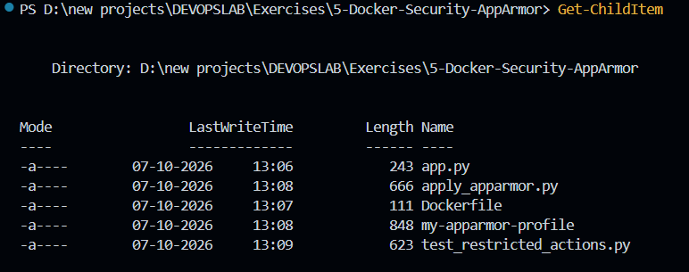
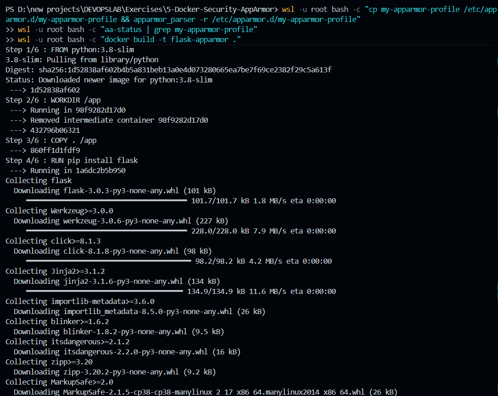
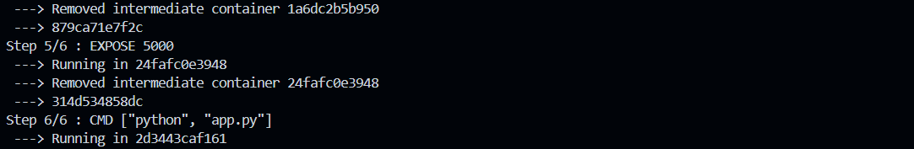

# Exercise 5 – Docker Security with AppArmor and Python

## Objective

Containerize a Flask application, write an AppArmor profile that restricts file access and binary execution, apply the profile to the container using the Docker CLI and the Docker SDK for Python, and test whether the restrictions are enforced.

## Environment

* OS: Windows with WSL2 (Ubuntu)
* Container Runtime: Docker Engine (installed inside Ubuntu)
* Language: Python 3.8 (container image `python:3.8-slim`), Flask
* Tools: `apparmor-utils`, Docker SDK for Python

## 1. Project Files

The exercise folder contains the application, the Dockerfile, the AppArmor profile, and the two Python scripts:

```powershell
Get-ChildItem
```

Files:

```text
app.py
apply_apparmor.py
Dockerfile
my-apparmor-profile
test_restricted_actions.py
```



## 2. AppArmor Profile

The profile `my-apparmor-profile`:

* allows IPv4 TCP networking and the `net_bind_service` capability for Flask on port 5000
* denies the `sys_admin` capability
* allows Python and its libraries to run, and read/write access to `/app`
* denies access to `/etc/passwd`, `/etc/shadow`, writes to `/etc`, and all access to `/var`
* denies execution of binaries in `/bin`, `/usr/bin` and `/sbin`

The profile in the lab sheet was adjusted in two ways:

* The profile is named `my-apparmor-profile` (instead of `/usr/bin/python3`) so that Docker can find it with `--security-opt apparmor=my-apparmor-profile`.
* Rules allowing Python's own files were added, and the `/etc` rule was narrowed, so the container can still start.

## 3. Load the Profile and Build the Image

```powershell
wsl -u root bash -c "cp my-apparmor-profile /etc/apparmor.d/my-apparmor-profile && apparmor_parser -r /etc/apparmor.d/my-apparmor-profile"
wsl -u root bash -c "aa-status | grep my-apparmor-profile"
wsl -u root bash -c "docker build -t flask-apparmor ."
```

The profile was copied to `/etc/apparmor.d/` and loaded, and `aa-status` listed `my-apparmor-profile`. The image `flask-apparmor` was built from `python:3.8-slim` with Flask installed.



The final build steps exposed port 5000 and set the container command to `python app.py`:



## 4. Run the Container with the Profile

```powershell
wsl -u root bash -c "docker run -d --name flask-secure --security-opt apparmor=my-apparmor-profile -p 5000:5000 flask-apparmor"
Start-Sleep -Seconds 3
wsl -u root bash -c "curl -s localhost:5000"
wsl -u root bash -c "docker inspect flask-secure --format '{{.AppArmorProfile}}'"
```

The container started, the application responded with:

```text
Hello, this is a secure Flask application running inside a Docker container!
```

and `docker inspect` reported the profile `my-apparmor-profile`.


## 5. Apply the Profile and Test Restrictions with the Docker SDK

```powershell
wsl -u root python3 apply_apparmor.py
wsl -u root python3 test_restricted_actions.py
```

`apply_apparmor.py` started the container with `security_opt=["apparmor=my-apparmor-profile"]` and printed the applied option. `test_restricted_actions.py` then tried two restricted actions inside the container:

| Action | Expected | Observed |
|---|---|---|
| `cat /etc/passwd` | Blocked | Succeeded, user entries were printed |
| `/bin/bash` | Blocked | Exit code 0 |


## 6. Observations and Limitations

The profile was **loaded** and **attached** to the container (visible in `aa-status` and `docker inspect`), but the restricted actions were **not blocked** in this environment.

Checking `docker info --format '{{.SecurityOptions}}'` inside WSL2 listed only `seccomp` and `cgroupns` and not `apparmor`. This indicates that the Docker daemon in this WSL2 setup was not using AppArmor, so the profile was recorded in the container settings but not enforced. Enabling AppArmor in the WSL2 kernel (`apparmor=1 security=apparmor` in `.wslconfig`) and mounting `securityfs` allowed the profile to load, but Docker still did not report AppArmor support. The exact cause was not fully determined.

To see the restrictions enforced, the same files should be run on a native Linux host or a Linux VM (for example Ubuntu on Multipass or VirtualBox), where Docker reports `name=apparmor` and `cat /etc/passwd` and `/bin/bash` fail with "Permission denied" (exit code 126).

## 7. Answers to the Questions

**What is the purpose of using AppArmor with Docker containers?**
AppArmor enforces security policies that confine an application to a limited set of files, network access and capabilities, adding a layer of protection beyond container isolation.

**How do AppArmor profiles help secure a Docker container?**
A profile defines what the containerized process may read, write, execute and which capabilities it may use, so a compromised application cannot freely affect the container or the host.

**Why is it important to restrict access to sensitive directories such as `/etc/` and `/var/`?**
They hold system configuration, user information and logs. Restricting them prevents the container from reading or modifying files that could be used to escalate an attack.

**What other capabilities can you restrict using AppArmor profiles?**
Network access and socket types, specific Linux capabilities (such as `sys_admin`), file read/write/execute permissions, mounting, signals and ptrace.

**How can you verify if an AppArmor profile is successfully applied to a Docker container?**
Check `docker inspect` (`HostConfig.SecurityOpt` and `AppArmorProfile`) and `aa-status`. To confirm it is actually *enforced*, also check that `docker info` lists `name=apparmor` and that restricted actions inside the container fail.

## 8. Commands Used

```powershell
Get-ChildItem

wsl -u root bash -c "cp my-apparmor-profile /etc/apparmor.d/my-apparmor-profile && apparmor_parser -r /etc/apparmor.d/my-apparmor-profile"
wsl -u root bash -c "aa-status | grep my-apparmor-profile"
wsl -u root bash -c "docker build -t flask-apparmor ."

wsl -u root bash -c "docker run -d --name flask-secure --security-opt apparmor=my-apparmor-profile -p 5000:5000 flask-apparmor"
wsl -u root bash -c "curl -s localhost:5000"
wsl -u root bash -c "docker inspect flask-secure --format '{{.AppArmorProfile}}'"

wsl -u root python3 apply_apparmor.py
wsl -u root python3 test_restricted_actions.py
```

## 9. Result

The Flask application was containerized, an AppArmor profile was written and loaded, and the container was run with the profile using both the Docker CLI and the Docker SDK for Python. In this WSL2 environment Docker did not enforce AppArmor, so the test actions were not blocked. The profile and test scripts are ready to be re-run on a Linux host with AppArmor support to demonstrate enforcement.