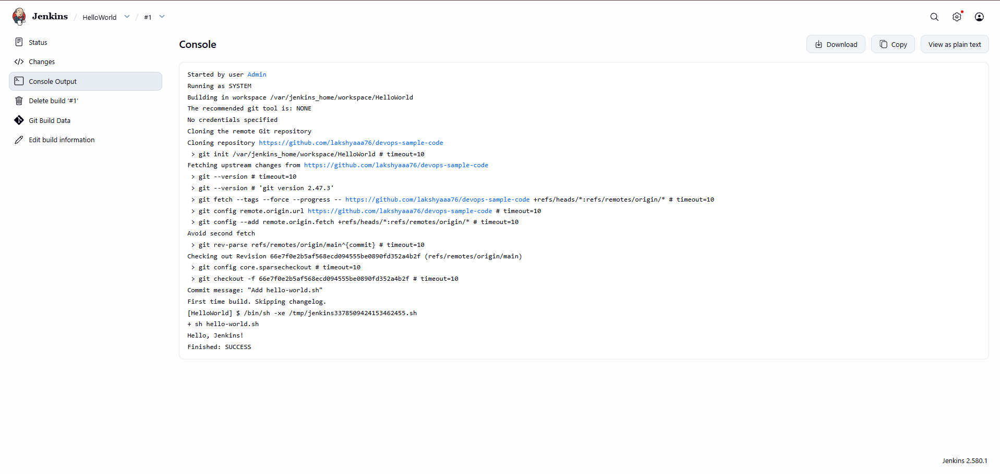

# Exercise 8 – Jenkins Hello World Job

## Objective

Run Jenkins in a Docker container, connect it to a GitHub repository containing a shell script, and create a Freestyle job that pulls the script from GitHub and executes it.

## Environment

* OS: Windows 11
* Container Runtime: Docker Desktop
* CI Tool: Jenkins (`jenkins/jenkins:lts`)
* Source Control: Git / GitHub
* Terminal: PowerShell (VS Code integrated terminal)

## Repository Used

The script used in this exercise is stored in a separate GitHub repository:

[https://github.com/lakshyaaa76/devops-sample-code](https://github.com/lakshyaaa76/devops-sample-code)

It contains a single file, `hello-world.sh`:

```bash
#!/bin/bash
echo "Hello, Jenkins!"
```

## 1. Start the Jenkins Container

Run Jenkins in Docker with a persistent `jenkins_home` volume:

```powershell
docker rm -f jenkins
docker volume rm jenkins_home
docker run -d --name jenkins -p 8080:8080 -p 50000:50000 -v jenkins_home:/var/jenkins_home jenkins/jenkins:lts
```

Verify that the container is running:

```powershell
docker ps
```

`docker ps` shows the `jenkins` container running with ports `8080` and `50000` mapped.

Get the initial admin password:

```powershell
docker exec jenkins cat /var/jenkins_home/secrets/initialAdminPassword
```

The password was used to unlock Jenkins at `http://localhost:8080`, followed by installing the suggested plugins and creating an admin user.


## 2. Create the Job

In the Jenkins dashboard:

1. Click **New Item**.
2. Enter the name `HelloWorld`.
3. Select **Freestyle project**.
4. Click **OK**.

The New Item page also offers Pipeline, Multi-configuration project, Folder, Multibranch Pipeline and Organization Folder.


## 3. Configure the Job

**Description:**

```text
Hello World! Jenkins job.
```

**Source Code Management:**

* Select **Git**
* Repository URL: `https://github.com/lakshyaaa76/devops-sample-code.git`
* Branch Specifier: `*/main`

**Build Steps:**

Click **Add build step → Execute shell** and enter:

```bash
sh hello-world.sh
```

Click **Save**.

## 4. Run the Build

On the job page, click **Build Now**. Build `#1` appears under **Build History**.

## 5. View the Console Output

Open build `#1` and click **Console Output**.

The log shows:

* Jenkins cloned the `devops-sample-code` repository from GitHub
* Checked out commit `66ef70e` with the message "Add hello-world.sh"
* Executed `hello-world.sh`

```text
Hello, Jenkins!
Finished: SUCCESS
```



## 6. How It Works

```text
GitHub (devops-sample-code)
   ↓
Jenkins Git plugin clones the repository
   ↓
Jenkins workspace
   ↓
Execute shell step runs hello-world.sh
   ↓
Console Output: "Hello, Jenkins!"
```

* The Git plugin clones the repository into the job workspace on each build.
* The **Execute shell** step runs inside that workspace, so `hello-world.sh` is found directly.
* Jenkins marks the build `SUCCESS` when the script exits with code `0`.
* The `jenkins_home` volume keeps jobs and settings even if the container is removed.

## 7. Commands Used

```powershell
docker rm -f jenkins

docker volume rm jenkins_home

docker run -d --name jenkins -p 8080:8080 -p 50000:50000 -v jenkins_home:/var/jenkins_home jenkins/jenkins:lts

docker ps

docker exec jenkins cat /var/jenkins_home/secrets/initialAdminPassword
```

## 8. Result

Jenkins was run in Docker with a persistent volume and connected to the `devops-sample-code` GitHub repository. The `HelloWorld` Freestyle job pulled `hello-world.sh`, executed it, and finished with `SUCCESS`, printing `Hello, Jenkins!` in the console output.