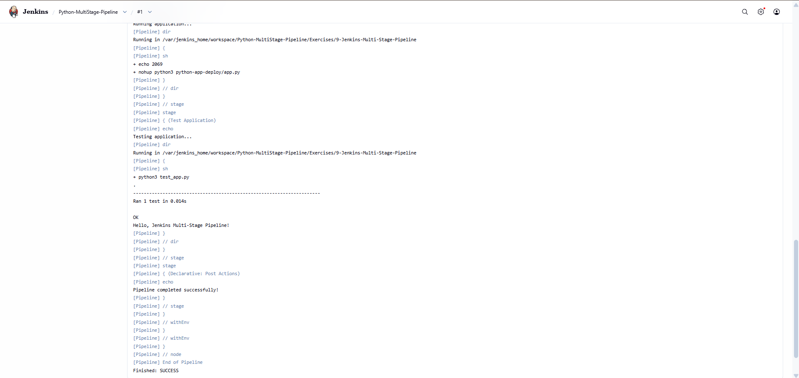

# Exercise 9 – Jenkins Multi-Stage Pipeline

## Objective

Create a Jenkins Pipeline that builds, tests, deploys and runs a Python Flask application using multiple stages, with the pipeline defined in a `Jenkinsfile` stored in a Git repository.

## Environment

* OS: Windows 11
* CI Server: Jenkins (LTS) running in Docker
* Container Runtime: Docker Desktop
* Language: Python 3 / Flask
* Source Control: GitHub
* Shell: PowerShell

## 1. Start Jenkins

Run Jenkins as a Docker container with a persistent volume:

```powershell
docker run -d --name jenkins -p 8080:8080 -p 50000:50000 -v jenkins_home:/var/jenkins_home jenkins/jenkins:lts
```

Get the initial admin password:

```powershell
docker exec jenkins cat /var/jenkins_home/secrets/initialAdminPassword
```

Jenkins was opened at `http://localhost:8080`, the suggested plugins (including the Pipeline plugin) were installed, and an admin user was created.

## 2. Install Python in the Jenkins Container

The default Jenkins image does not include Python, so the first pipeline run fails with missing `python3` and `pip` errors. Install the dependencies inside the container:

```powershell
docker exec -u root jenkins bash -c "apt-get update && apt-get install -y python3 python3-pip python3-venv python3-flask"
docker exec jenkins python3 --version
```

## 3. Create the Application

The application files live in `Exercises/9-Jenkins-Multi-Stage-Pipeline`:

* `app.py` – a Flask app that returns `Hello, Jenkins Multi-Stage Pipeline!` on `/`
* `requirements.txt` – pins `flask==2.1.2`
* `test_app.py` – a unit test that checks the home route returns status `200` and the expected message

## 4. Define the Jenkinsfile

The `Jenkinsfile` defines five stages. Since the repository contains several exercises, each stage runs inside the exercise folder using `dir(...)`.

| Stage | What it does |
|---|---|
| Build | Checks the Python and Flask installation |
| Test | Runs `python3 -m unittest discover -s .` |
| Deploy | Copies `app.py` into a `python-app-deploy` folder |
| Run Application | Starts the deployed app with `nohup` and saves its PID to `app.pid` |
| Test Application | Runs `test_app.py` against the application |

A `post` block prints `Pipeline completed successfully!` on success and a failure message otherwise.

## 5. Push to GitHub

```powershell
git add .
git commit -m "Add Jenkins multi-stage pipeline exercise"
git push
```

## 6. Create the Jenkins Job

1. Click **New Item**, name it `Python-Multistage-Pipeline` and select **Pipeline**.
2. Under **Pipeline**, set **Definition** to *Pipeline script from SCM*.
3. Set **SCM** to *Git* and enter the repository URL.
4. Set **Branch Specifier** to `*/main`.
5. Set **Script Path** to `Exercises/9-Jenkins-Multi-Stage-Pipeline/Jenkinsfile`.
6. Click **Save**.

## 7. Run the Pipeline

Click **Build Now**, then open the build and select **Console Output**.

The pipeline executed all stages successfully:

* Deploy Application → ran `app.py` with `nohup`
* Test Application → ran `test_app.py`, 1 test passed
* The test printed `Hello, Jenkins Multi-Stage Pipeline!`
* The final log showed `Pipeline completed successfully!`
* Status: `SUCCESS`



## 8. Verify the Deployment

List the deployed files inside the Jenkins workspace:

```powershell
docker exec jenkins ls /var/jenkins_home/workspace/Python-Multistage-Pipeline/Exercises/9-Jenkins-Multi-Stage-Pipeline/python-app-deploy
```

Output:

```text
app.log
app.pid
app.py
```

* `app.py` is the deployed application copy.
* `app.log` holds the output of the running application.
* `app.pid` stores the process ID of the running application.


## 9. Pipeline Flow

```text
GitHub Repository
   ↓
Jenkins (Pipeline script from SCM)
   ↓
Checkout
   ↓
Build
   ↓
Test
   ↓
Deploy
   ↓
Run Application
   ↓
Test Application
   ↓
Post Actions (SUCCESS)
```

* Jenkins pulls the repository and reads the `Jenkinsfile` from the configured script path.
* Each stage runs in order, and the pipeline stops if any stage fails.
* The Deploy stage simulates a deployment by copying the application to a separate directory.
* The Run Application stage starts the deployed app in the background.
* The Post section reports the final result.

## 10. Commands Used

```powershell
docker run -d --name jenkins -p 8080:8080 -p 50000:50000 -v jenkins_home:/var/jenkins_home jenkins/jenkins:lts

docker exec jenkins cat /var/jenkins_home/secrets/initialAdminPassword

docker exec -u root jenkins bash -c "apt-get update && apt-get install -y python3 python3-pip python3-venv python3-flask"

git add .
git commit -m "Add Jenkins multi-stage pipeline exercise"
git push

docker exec jenkins ls /var/jenkins_home/workspace/Python-Multistage-Pipeline/Exercises/9-Jenkins-Multi-Stage-Pipeline/python-app-deploy
```

## 11. Result

The multi-stage Jenkins pipeline ran successfully. The Flask application was tested, deployed to a separate directory, started in the background, and tested again, and the build finished with status `SUCCESS`. The deployed files (`app.py`, `app.log`, `app.pid`) were confirmed inside the Jenkins workspace.